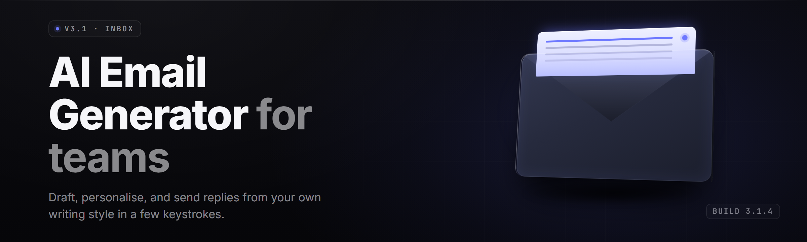

  
  
  

  

  
  
  

---

**AI Email Generator Studio 2026** — compose, personalize, and ship cold outreach that reads like *you* wrote it at 2am on your best day.

---

## 🧭 Table of Contents

- [Overview](#-overview)
- [What is AI Email Generator Studio](#-what-is-ai-email-generator-studio)
- [The Problem](#-the-problem)
- [The Solution](#-the-solution)
- [Key Features](#-key-features)
- [Quick Start](#-quick-start)
- [Installation](#-installation)
- [Compatibility & Platform Support](#-compatibility--platform-support)
- [Usage Guidelines](#-usage-guidelines)
- [Grouped Module Catalog](#-grouped-module-catalog)
- [System Requirements](#-system-requirements)
- [Tips for Best Results](#-tips-for-best-results)
- [Known Issues](#-known-issues)
- [FAQ](#-faq)
- [Changelog](#-changelog)

---

## 📬 Overview

AI Email Generator Studio is a Windows desktop app that turns a one-line brief into a fully drafted, tone-matched, sequence-ready email — then lets you personalize it at scale against your own contact list. It runs locally, ships as a single `.exe`, and never phones home with your drafts.

| Category | Details |
|---|---|
| **Product type** | Windows desktop `.exe` (portable, no installer) |
| **Primary use** | Cold outreach, follow-up sequences, support replies, newsletters |
| **Model backend** | Local inference engine + optional BYO remote endpoint |
| **Data handling** | Drafts stored locally in an encrypted SQLite vault |
| **Best for** | Founders, SDRs, freelancers, recruiters, indie hackers |
| **First release** | 2024 · current build **2026.1** |
| **Distribution** | Download → extract → run `.exe` |
| **Detection/updates** | see FAQ for detection/updates |

I built this because I was tired of copy-pasting the same skeleton into four different tools just to send one decent follow-up. Months on my main, and the thing finally does what I wanted a year ago.

---

## 📖 What is AI Email Generator Studio

A glossary for anyone landing here cold.

| Term | Explanation |
|---|---|
| **Brief** | The one-line prompt you type — e.g. "founder, seed-stage, no reply yet, warm." |
| **Sequence** | An ordered set of emails (initial + N follow-ups) with timing rules. |
| **Tone Profile** | A saved voice preset — "concise operator," "warm peer," "formal enterprise." |
| **Merge Field** | A `{{token}}` like `{{first_name}}` or `{{company}}` injected from your contact CSV. |
| **Vault** | The local encrypted store holding drafts, contacts, and profiles. |
| **Deliverability Score** | A pre-send heuristic flagging spammy phrasing, link density, ALL-CAPS. |
| **Endpoint** | The model backend — local engine by default, or your own remote API. |

**What you actually get:**

- A one-line brief turning into a sendable draft in under ten seconds.
- Tone profiles that keep every email in a sequence sounding like the same human.
- A deliverability linter that catches the obvious "this lands in spam" mistakes.
- Bulk personalization across thousands of contacts from a CSV.
- Everything stored on-disk, encrypted, offline by default.

---

## 🩹 The Problem

Cold email sucks for reasons that have nothing to do with your product.

- **Blank-page paralysis.** You know what you want to say. You still stare at an empty compose window for twenty minutes.
- **Tone drift.** Email one sounds confident. Email four sounds like a robot begging for a reply.
- **Tool sprawl.** One tab for the template, one for the AI, one for the tracker, one for the CSV. Nothing talks.
- **Deliverability roulette.** You don't find out you tripped a spam filter until you've sent 400 emails into a void.
- **Personalization tax.** True per-contact personalization takes four minutes per email. Nobody sustains that past fifty contacts.
- **Privacy anxiety.** Pasting your prospect list into a random web tool and hoping it isn't training on your pipeline.
- **No memory.** Every session starts from zero because nothing remembers what worked last time.

---

## ✅ The Solution

| Problem | Solution |
|---|---|
| Blank-page paralysis | Brief-to-draft engine — type six words, get a full email. |
| Tone drift | Tone Profiles locked across an entire sequence. |
| Tool sprawl | One window: brief, draft, sequence, contacts, linter, export. |
| Deliverability roulette | Pre-send Deliverability Score with inline fixes. |
| Personalization tax | Merge-field engine + per-row rewrite against your CSV. |
| Privacy anxiety | 100% local by default; encrypted vault; no telemetry. |
| No memory | Vault remembers every profile, sequence, and winning draft. |

---

## 🎯 Key Features

| Feature | Description | Benefit |
|---|---|---|
| **Brief Composer** | One-line input → full draft in seconds. | Kills the blank page. |
| **Tone Profiles** | Reusable voice presets per audience. | Consistency across a sequence. |
| **Sequence Builder** | Multi-step cadences with delay rules. | No more manual follow-up calendar. |
| **Merge Engine** | `{{token}}` injection from CSV columns. | Real personalization at scale. |
| **Deliverability Linter** | Flags spammy phrasing, link density, caps. | Fewer spam-folder deaths. |
| **CSV Ingest** | Drop a contact list, map columns, go. | Bulk mode without spreadsheets. |
| **Rewrite Modes** | Shorten, sharpen, soften, formalize, punch up. | One-click tone surgery. |
| **Vault** | Encrypted local store for everything. | Your pipeline stays yours. |
| **Export Pack** | `.eml`, `.txt`, `.csv`, and clipboard formats. | Fits whatever sender you already use. |
| **Endpoint Switch** | Local engine or your own remote API. | Bring your own model if you want. |
| **Subject Lab** | Generates and scores 10 subject lines per draft. | Higher open rates without guesswork. |
| **Undo History** | Full draft timeline per email. | Never lose the version you liked. |

---

## ⚙️ Quick Start

1. 📄 Grab the build from the landing page.
2. 📦 Extract the archive to a folder you own (not `Program Files`).
3. ▶️ Double-click the `.exe`. First launch provisions the local vault.
4. ✍️ Type a brief, pick a Tone Profile, hit **Generate**.
5. 📤 Export or copy straight into your sender of choice.

### ⬇️ Download

  

---

## 🛠️ Installation

### 1. Download the archive
Head to the project landing page and pull the current Windows build. You'll get a `.zip` containing the `.exe` and a `profiles/` folder with starter tone presets.

### 2. Extract, don't run-in-place
Right-click → **Extract All** into a normal folder like `C:\Tools\AIEmailStudio`. Running the `.exe` directly from inside the zip will break the vault path.

### 3. First run
Double-click the `.exe`. Windows SmartScreen may prompt — click **More info → Run anyway**. The app creates its encrypted vault on first launch and drops a sample contact CSV in the folder so you can test the merge engine immediately.

> No installer, no registry writes, no background services. Delete the folder to uninstall.

---

## 🖥️ Compatibility & Platform Support

| Platform | Supported | Notes |
|---|---|---|
| Windows 11 (x64) | ✅ Full | Primary target, tested build. |
| Windows 10 21H2+ (x64) | ✅ Full | Fully supported. |
| Windows 10 (ARM) | ⚠️ Partial | Runs under emulation, slower inference. |
| Windows 8.1 | ❌ No | Requires .NET 8 runtime unavailable on this OS. |
| macOS | ❌ No | Not a target platform. |
| Linux (Wine) | ⚠️ Unofficial | Community reports mixed results. |

---

## 📋 Usage Guidelines

| ✅ Allowed | ❌ Not allowed |
|---|---|
| Your own contact lists and opt-in subscribers | Scraped lists you have no consent for |
| Legitimate cold outreach in your jurisdiction | Bulk unsolicited spam to harvested addresses |
| Local drafts, exports, and backups | Redistributing the `.exe` as your own product |
| BYO remote endpoints for your own account | Reselling access to the app as a service |
| Support replies and internal comms | Impersonating a real person without disclosure |

This is a drafting tool. What you send and to whom is your call and your responsibility.

---

## 🧩 Grouped Module Catalog

### ✍️ Compose Modules

- **Brief Composer** — one-line input, full-length draft out.
- **Subject Lab** — ten subject candidates, scored by heuristic.
- **Rewrite Modes** — shorten, sharpen, soften, formalize, punch up.
- **Length Dial** — snap the draft to 50 / 100 / 150 / 250 words.
- **CTA Picker** — swaps the call-to-action to match your funnel stage.

### 🎚️ Tone & Voice Modules

- **Tone Profiles** — saved voice presets you reuse across campaigns.
- **Voice Match** — paste an email you already wrote, clone its voice.
- **Formality Slider** — casual ↔ formal, continuous.
- **Persona Tags** — "operator," "peer," "vendor," "recruiter."
- **Banned-Phrase List** — words the generator will never emit.

### 🧵 Sequence Modules

- **Cadence Builder** — initial + up to 8 follow-ups.
- **Delay Rules** — send gaps in days, hours, or business-day-only.
- **Branch Logic** — different step 3 depending on step 2's intent.
- **Thread Merge** — folds replies into the sequence view.
- **Sequence Templates** — starter cadences for common plays.

### 🧬 Personalization Modules

- **Merge Engine** — `{{token}}` injection from CSV columns.
- **Column Mapper** — maps any header to a merge field.
- **Per-Row Rewrite** — rewrites each email against its own row.
- **Fallback Rules** — what to do when a token is empty.
- **Segment Splitter** — bucket contacts by column value.

### 🛡️ Deliverability Modules

- **Deliverability Score** — pre-send spam heuristic, 0–100.
- **Link Density Check** — flags too many links per paragraph.
- **Caps & Punct Linter** — catches shouting and `!!!!`.
- **Spam-Phrase Scan** — matches against a maintained blocklist.
- **Plain-Text Preview** — shows what a text-only client will see.

### 🗄️ Vault & Export Modules

- **Encrypted Vault** — local SQLite store, AES-GCM at rest.
- **Export Pack** — `.eml`, `.txt`, `.csv`, clipboard.
- **History Timeline** — every draft version, restorable.
- **Backup / Restore** — one-file vault export.
- **Endpoint Switch** — local engine or your remote API.

---

## 🖥️ System Requirements

| Component | Minimum | Recommended |
|---|---|---|
| **OS** | Windows 10 21H2 (x64) | Windows 11 (x64) |
| **CPU** | 4 cores, 2.0 GHz | 8 cores, 3.0 GHz+ |
| **RAM** | 8 GB | 16 GB |
| **GPU** | Not required | 6 GB VRAM (local inference) |
| **Disk** | 2 GB free | 8 GB free (SSD) |
| **Runtime** | .NET 8 Desktop Runtime | .NET 8 Desktop Runtime |
| **Network** | Optional (local mode) | Required only for remote endpoints |

---

## 💡 Tips for Best Results

- Write the brief like you'd text a colleague — "warm, no reply yet, seed founder" beats "professional introduction email."
- Save a Tone Profile the first time a draft lands. Reuse it across the whole sequence.
- Run the Deliverability Score *before* you export, not after you send.
- Keep merge fields to three or fewer per email. More reads like mail merge.
- Use the Banned-Phrase List to strip the words you never want to see again.
- Test a sequence against five real contacts before you run it against five hundred.
- Back up the vault before big imports — one file, ten seconds.

---

## ⚠️ Known Issues

| Issue | Solution |
|---|---|
| SmartScreen blocks first run | Click **More info → Run anyway**; it's an unsigned portable build. |
| Vault path error on launch | Move the `.exe` out of the zip into a normal folder and relaunch. |
| Slow inference on 8 GB RAM | Switch to a remote endpoint or reduce draft length. |
| CSV column mapping resets | Re-map and hit **Save Mapping** to persist it per file. |
| Merge tokens render empty | Check the Fallback Rules for that token. |
| GPU mode crashes on old drivers | Update to the latest vendor driver or fall back to CPU mode. |

---

## ❓ FAQ

<b>Is this detected by spam filters?</b>

The app can't control your sender reputation, domain, or list quality. What it *does* is run a Deliverability Score before you send, flagging the phrasing and link density that most commonly trip filters. Fix the flags, and your odds improve — no tool can guarantee inbox placement.

<b>How do updates work?</b>

There's no auto-updater. You re-download the current build from the landing page, extract over your existing folder, and your vault carries over untouched. Check the changelog for what changed.

<b>Does it run offline?</b>

Yes. The default local inference engine runs entirely on your machine. Network is only touched if you deliberately switch to a remote endpoint.

<b>Where are my drafts stored?</b>

In an encrypted SQLite vault inside the app folder. AES-GCM at rest. No telemetry, no cloud sync, no phone-home.

<b>Can I use my own model endpoint?</b>

Yes. Open **Endpoint Switch**, point it at your own API, and the app routes generation there instead of the local engine.

**Q:** Can I import a CSV with custom column names?
**A:** Yes — the Column Mapper lets you bind any header to any merge token, and you can save the mapping per file.

**Q:** Does it send emails for me?
**A:** No. It drafts and exports. Sending stays in your existing client or sender, so your reply handling never changes.

**Q:** How many contacts can it handle?
**A:** Bulk mode comfortably processes tens of thousands of rows; per-row rewrite is the slow step and scales with your hardware.

**Q:** Is there a Mac version?
**A:** Not a target platform. Windows only.

---

## 📝 Changelog

- **2026.1** — Deliverability Score v2, Sequence branch logic, GPU inference path.
- **2025.4** — CSV Column Mapper, per-file mapping persistence, Vault backup export.
- **2025.1** — Tone Profiles, Voice Match, Subject Lab.

---

The point of this build was never to send *more* email — it was to send email that sounds like a person who actually meant it. Brief in, draft out, tone intact, your data staying on your disk. If it saves you one blank-page afternoon, it did its job.

  

absolute potato to you, Sam.
